# teach-ja — 日本語対応の Claude Code 用 `/teach` スキル

**[English README → README.md](./README.md)**

`teach-ja` は、任意のフォルダを自分専用の**学習ワークスペース**に変えるスキルです。`/teach-ja` と学びたいことを入力すると、Claude が「なぜ学びたいのか」を面談で確認し、信頼できる情報源を探し、短くてインタラクティブな HTML レッスンを作ります。Claude があなたについて学んだことはすべてそのフォルダにファイルとして保存されるので、新しいチャットを開いても前回の続きから再開できます。

---

## 目次

1. [デモの流れ](#1-デモの流れ)
2. [内部の仕組み](#2-内部の仕組み)
3. [記憶（メモリ）の保存方法](#3-記憶メモリの保存方法)
4. [日本語対応のための変更点](#4-日本語対応のための変更点)
5. [インストール](#5-インストール)
6. [デモを自分で実行する](#6-デモを自分で実行する)
7. [コツ・制限・よくある質問](#7-コツ制限よくある質問)
8. [リポジトリ構成](#8-リポジトリ構成)
9. [クレジットとライセンス](#9-クレジットとライセンス)

---

## 1. デモの流れ

来月からチームで Git を使う学習者の例です。実際の実行結果を順に紹介します。

### ステップ1 — `/teach-ja` はレッスンではなく面談から始まる

学習者が日本語で1行書くと、スキルは言語を判定して `NOTES.md` に `言語: 日本語` を保存し、教える前に「なぜ」を質問します。目標、出発点、つまずいているところ、使える時間、文体（です・ます調など）です。

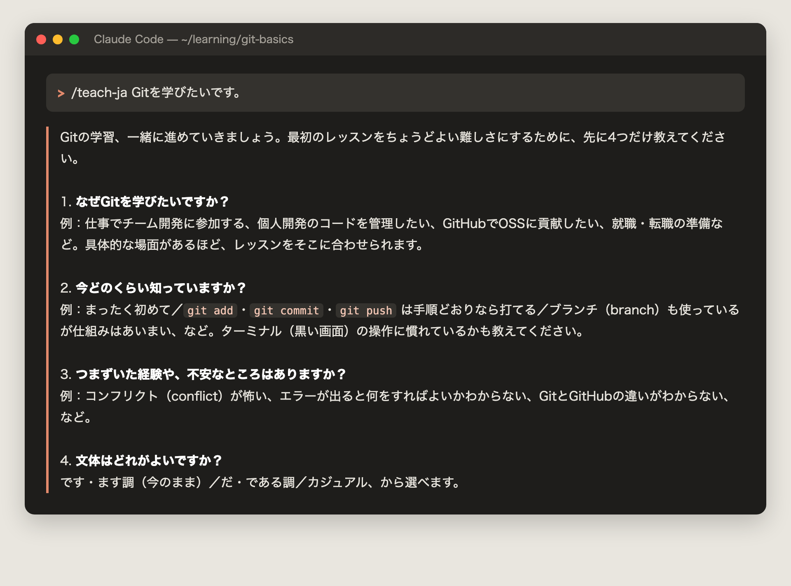

### ステップ2 — ミッション、情報源、そして最初のレッスン

回答を受けて `MISSION.md` を書き、信頼できる情報源を `RESOURCES.md` に集め、出発点を学習記録 `0001` に残し、本人が「あいまい」と言った点（ステージングとコミットの違い）を狙ったレッスン1を作ります。ミッションまでの約8回の道筋も提案します。

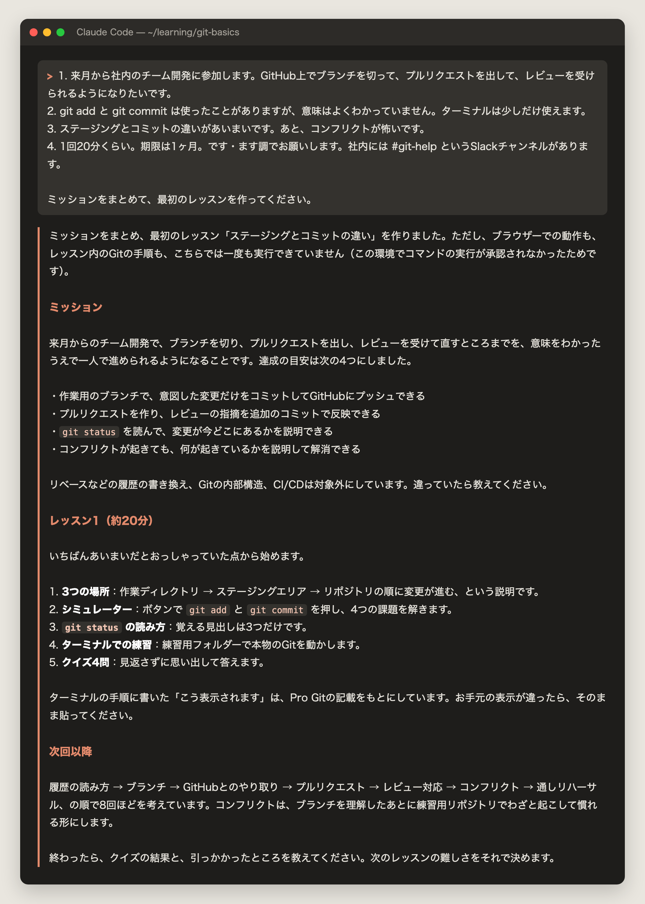

### ステップ3 — レッスン: 短く、出典つきで、ミッションにつながる

レッスンは共通の日本語スタイルシートを使った単体の HTML ファイルです。目標は1つ（今日できるようになること）、**この学習者にとっての**意味（来月のプルリクエストのレビュー）、図、出典 `[1]` `[2]`、そして初出の用語は「日本語（English）」で書かれます。

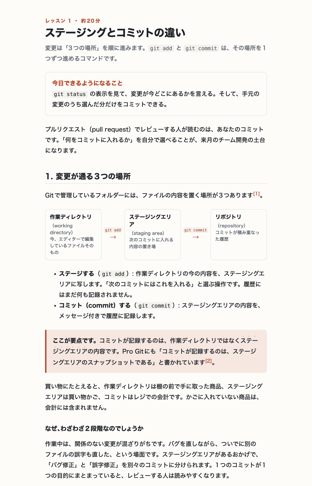

### ステップ4 — すぐにフィードバックが返る練習

スキルは再利用できる部品 `assets/three-areas.js` を自分で作りました。`git add` / `git commit` ボタンを押すと3つの場所が変化し、下に簡略化した `git status` が表示されるシミュレーターです。続いて、練習用フォルダーで本物のターミナルを使う演習があります。

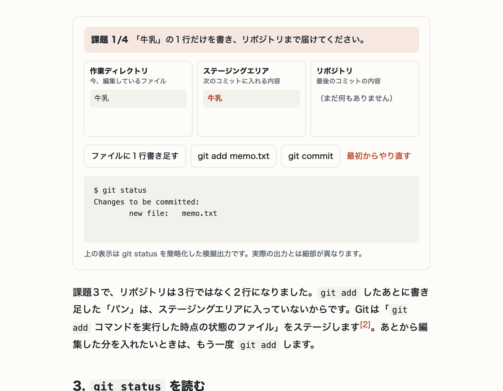

### ステップ5 — 思い出して答えるクイズ（シャッフル・同じ長さの選択肢）

選択肢は文字数も文の形もそろえてあり、`assets/quiz.js` が読み込むたびに並べ替えます。正解の位置は毎回変わります。不正解のときは理由と出典を示します。

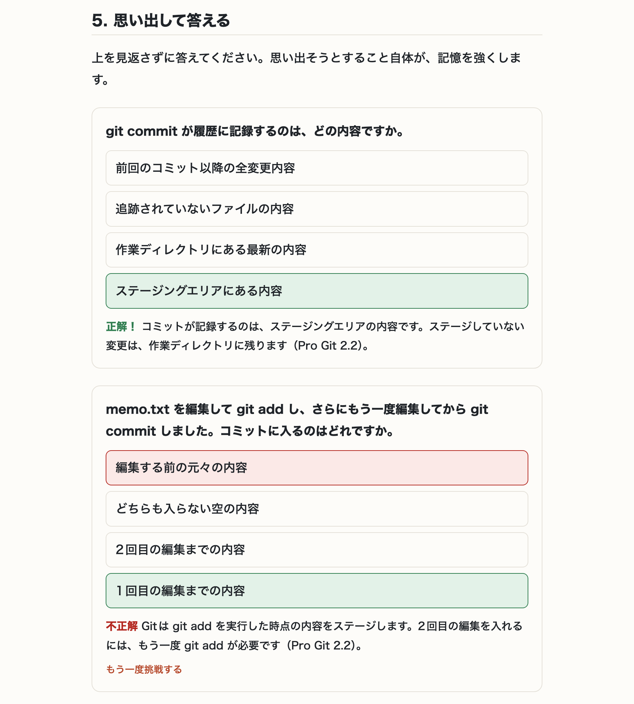

### ステップ6 — 一次情報源、コミュニティ、「先生に質問を」

各レッスンの最後には、推奨の一次情報源（Pro Git 公式日本語訳。英語原文へのリンクと「訳は少し古い」という注意つき）、社内の `#git-help` チャンネルの紹介、そして質問を促す一言があります。

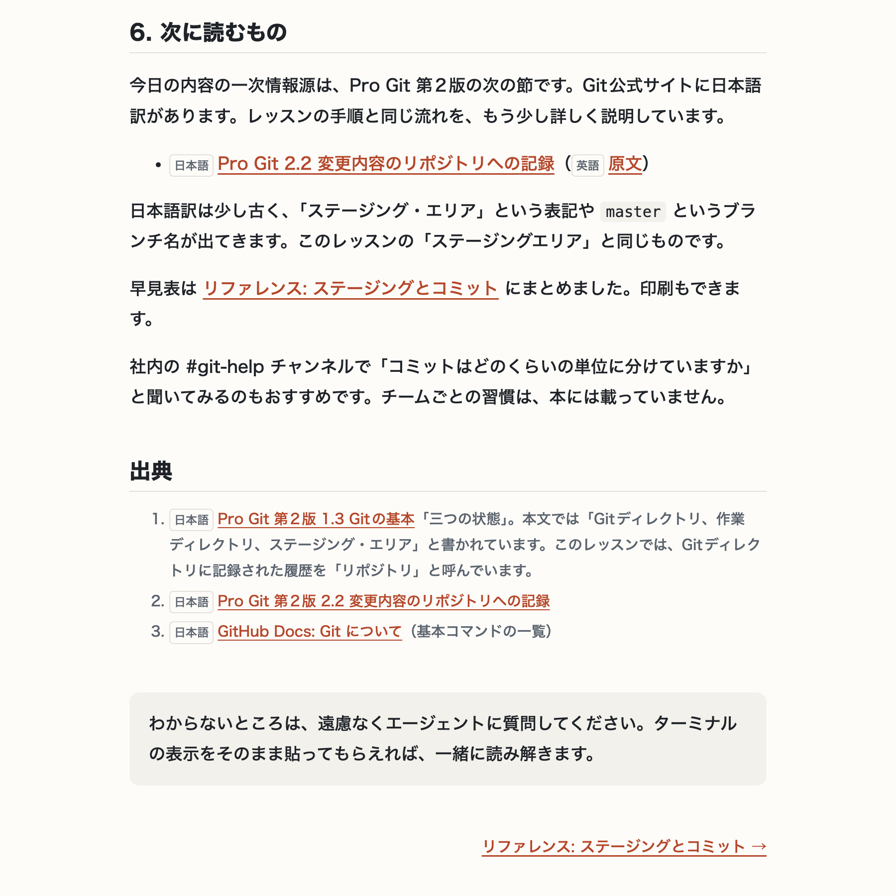

レッスンと一緒に、印刷できる早見表（`reference/staging-and-commit.html`）も作られます。後で何度も見返すのはこちらです。

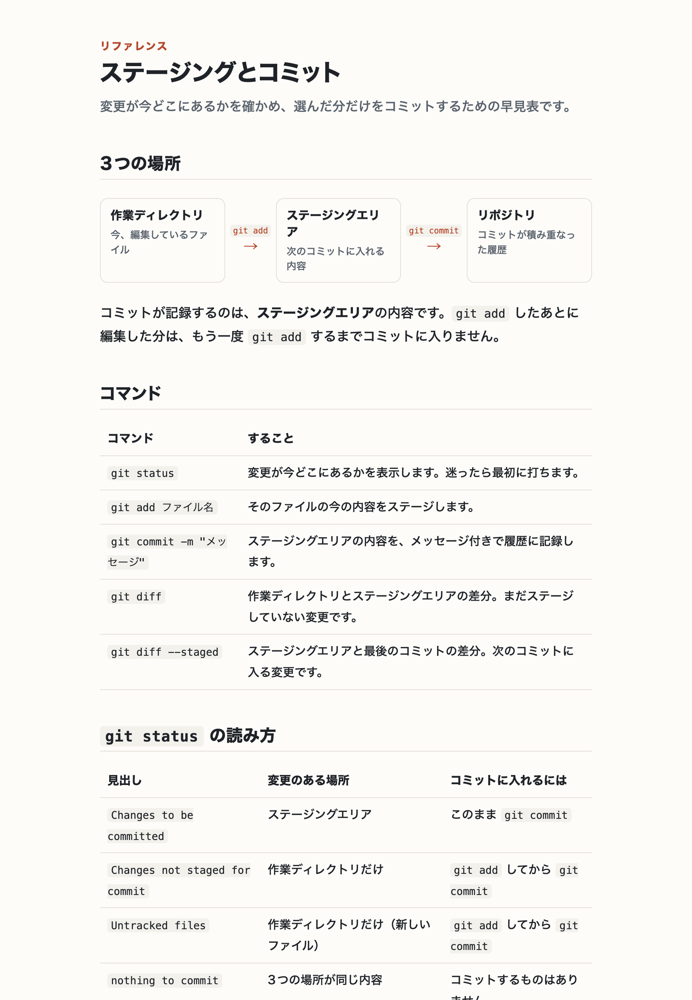

### ステップ7 — 学習者の報告 → 記憶が書かれる

学習者が「4問中3問正解」と報告し、間違えた理由を説明し、「ステージングエリアは次のコミットの下書き」と自分の言葉で言い換えます。これは理解の**証拠**であり、**誤解の修正**でもあるので、スキルは学習記録 `0002` を書き、学習者の言葉を使って `GLOSSARY.md` を作り、次回の復習を計画します。

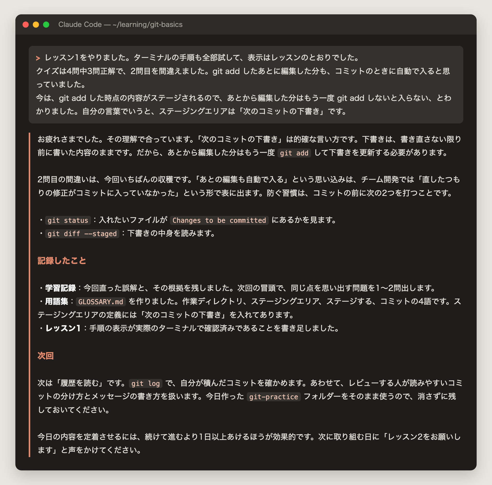

### ステップ8 — チャットを閉じて、新しいセッションで「次のレッスン」

同僚に見せたいのはここです。同じフォルダで、チャット履歴がまったくない**新しい** Claude Code セッションを開きます。

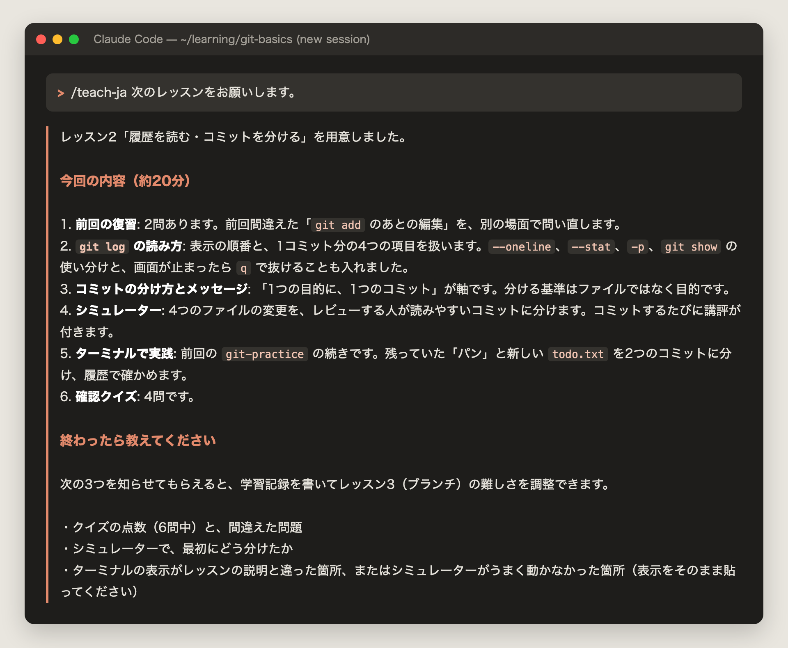

古いチャットではなくフォルダを読んでいることが、次の点からわかります。

- レッスン2は、`learning-records/0002` に記録された誤解そのものを、別の角度から問う**間隔をあけた復習**から始まります。
- レッスン1の `git-practice` フォルダー（ステージせずに残した「パン」の行も含む）の続きから始めます。
- 新しいシミュレーターは、ステージングエリアを「次のコミットの下書き」と表示します。`GLOSSARY.md` から拾った**学習者自身の言葉**です。

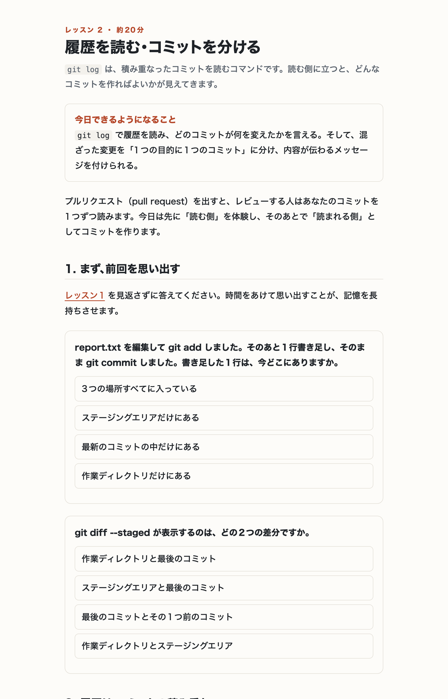

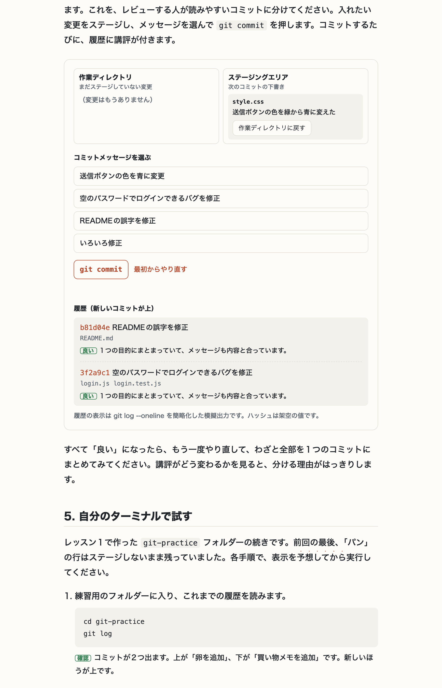

> **録画について。** 安全のため、録画用の実行では `git`・`node`・`open` を実行できない設定にしました（ファイルの読み書き、Web 検索、`mkdir`/`cp` のみ）。Claude は返答の中でそのことを正直に書いていますが、チャットのスクリーンショットではその環境に関する注記とローカルパスを省いています。両レッスンの Git の手順はすべてあとで実際の Git で実行し、レッスンの記述どおりであることを確認しました。JavaScript の部品もブラウザで操作し、エラーがないことを確認しています。

---

## 2. 内部の仕組み

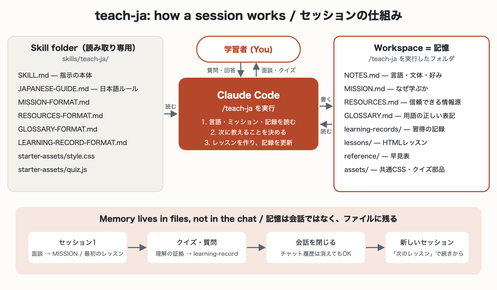

Claude Code の**スキル**は、`SKILL.md` というファイルが入ったフォルダにすぎません。中身は Markdown で書かれた指示と、短い YAML ヘッダーです。`/teach-ja` と入力すると、Claude Code がこのファイルを会話に読み込み、Claude がその指示に従って動きます。サーバーもデータベースも追加のプログラムもありません。「プログラム」は指示文で、「状態」は Claude が書き出すファイルです。

```yaml
---
name: teach-ja
description: Teach the user a new skill or concept, within this workspace, in Japanese or English (日本語対応の /teach).
disable-model-invocation: true        # あなたが /teach-ja と打ったときだけ動く（Claude が勝手に始めない）
argument-hint: "何を学びたいですか？ / What would you like to learn about?"
---
```

登場するフォルダは2つあり、これを分けて考えるのがポイントです。

| | スキルフォルダ（`skills/teach-ja/`） | ワークスペース（`/teach-ja` を実行したフォルダ） |
| --- | --- | --- |
| 役割 | 先生の**ルールブック** | 学習者の**記憶** |
| 誰が書くか | あなた／このリポジトリ | セッション中の Claude |
| 学習者ごとに変わるか | 変わらない（全員で共有） | 変わる（学習者×トピックごとに1つ） |
| 中身 | `SKILL.md`、`JAPANESE-GUIDE.md`、`*-FORMAT.md`、`starter-assets/` | `MISSION.md`、`NOTES.md`、`RESOURCES.md`、`GLOSSARY.md`、`learning-records/`、`lessons/`、`reference/`、`assets/` |

### `/teach-ja` のたびに Claude がすること

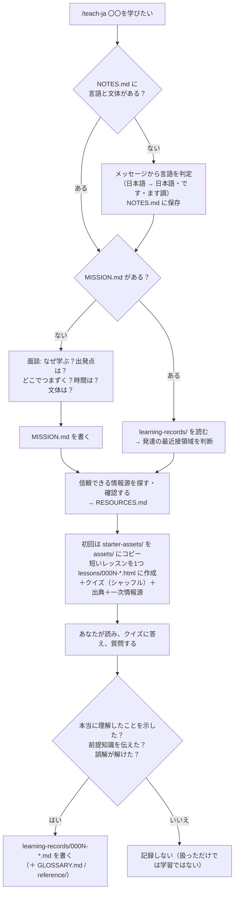

### 背景にある学習理論

スキルにはよく知られた学習科学の考え方が組み込まれていて、ほとんどの振る舞いはこれで説明できます。

- **ミッションが先。** 「なぜ」学ぶのかが分かるまでレッスンを作りません。「来月、自分でプルリクエストを出す」のような具体的な目標がないと、次に何を教えるべきか決められないからです。
- **知識 → スキル → 知恵。** 知識は信頼できる情報源から得ます（**自分の記憶を信用しない**よう指示されており、必ず出典を示します）。スキルは即時フィードバックのある練習（クイズ、小さな課題）で身につけます。知恵は実際の人から得るものなので、コミュニティ（社内チャンネルを含む）を紹介します。
- **発達の最近接領域。** 毎回「ちょうど少し難しい」レッスンにします。学習記録から判断します。
- **流暢さより保持力。** 読んでいる間に分かった気になることではなく、来月も覚えていることが目標です。そのため、思い出す練習（想起練習）、間隔をあけた反復、交互練習を使います。
- **小さなレッスン。** ワーキングメモリは小さいので、1レッスン＝1回で終わる1つの具体的な成果です。

---

## 3. 記憶（メモリ）の保存方法

Claude はチャットをまたいだ隠れた記憶を持っていません。**ワークスペースのフォルダそのものが記憶です。** 各ファイルの役割は1つずつです。

| ファイル | 書かれるタイミング | 読まれるタイミング | 例（デモより） |
| --- | --- | --- | --- |
| `NOTES.md` | 初回、好みを伝えたとき | 毎セッションの最初 | `言語 / Language: 日本語`、`文体 / Register: です・ます調` |
| `MISSION.md` | 面談の後、目標が変わったとき（あなたの確認後） | 何を教えるか決めるたび | なぜ学ぶか、達成の姿、出発点、制約、対象外 |
| `RESOURCES.md` | レッスン作成の前・途中 | 説明を書くとき | 公式ドキュメント、書籍、コミュニティ（［日本語］［英語］タグ付き） |
| `learning-records/000N-*.md` | 学んだ**証拠**があったとき、前提知識を伝えたとき、誤解が解けたときだけ | 次のレッスンを選ぶとき | `0001-staging-vs-commit.md` |
| `GLOSSARY.md` | 用語を正しく**使える**ようになったとき | 毎レッスン（表記を統一する） | **コミット（commit）** … _避ける表現_: 確定、セーブ |
| `lessons/000N-*.html` | 1セッションに1つ | あなたが復習するとき | 単体で開ける HTML レッスン |
| `reference/*.html` | 残す価値のあるまとめができたとき | あなたが頻繁に（A4 で印刷可） | コマンド早見表 |
| `assets/` | 初回レッスン（`starter-assets/` からコピー）、その後増える | 毎レッスンの前（まず再利用） | `style.css`、`quiz.js` |

**学習記録は、頭の中の ADR（設計判断記録）のようなものです。** 短く、番号付きで、削除しません。理解が変わったら、古い記録に `status: superseded by LR-000N` と付けます。「X を扱った」は記録になりません。「学習者が X を自分の言葉で正しく説明した」が記録になります。

記憶がファイルにあるので、次のことができます。

- **チャットを閉じて、来週戻ってこられます。** 同じフォルダで Claude Code を開き、`/teach-ja 次のレッスン` と入力するだけです。
- Claude があなたについてどう考えているかを**読んで、直せます。** レベルが合わなければ `MISSION.md` や学習記録を編集します。
- **フォルダを Git にコミットして**、チームでコースを共有できます。

上の4ターンのあと、ワークスペースはこうなっています。Claude が学習者を「覚えて」おくために使うファイルは、すべて読めるテキストファイルです。

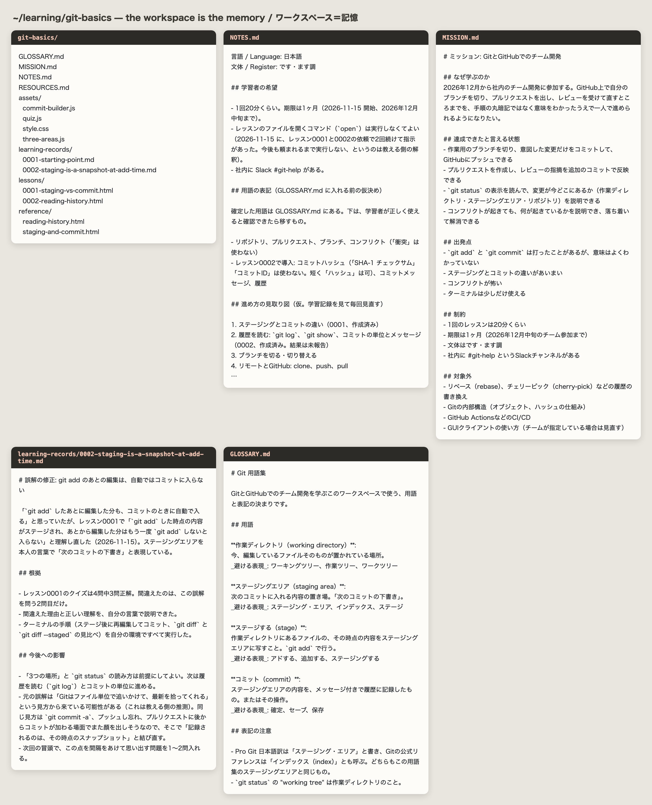

デモで指摘したいポイント:

- `NOTES.md` の先頭に言語と文体の行があるので、以降のセッションは指示しなくても です・ます調の日本語で話します。
- `learning-records/0002` には、**根拠**（クイズ4問中3問正解、間違いを自分の言葉で説明）、**今後への影響**（次に何を教えるか）、さらに誤解が**なぜ**起きたかの仮説と、どこで再び現れそうかまで書かれています。
- `GLOSSARY.md` は概念ごとに表記を1つに決め、避ける表記を挙げています。Pro Git 日本語訳が別の表記を使っている理由まで書いてあります。
- 学習者はこれらのファイルを開いて直せます。それが「先生」を操作する方法です。

---

## 4. 日本語対応のための変更点

理由つきの全一覧は [CHANGES.md](./CHANGES.md) にあります。元のファイルは [`upstream/`](./upstream/) にそのまま残してあるので、`diff -u upstream/SKILL.md skills/teach-ja/SKILL.md` ですべての差分を確認できます。

| 元のスキルを日本語で使ったときの問題 | `teach-ja` での対応 |
| --- | --- |
| 何語で書くかの指定がない | **Language / 言語** セクション: `NOTES.md` またはメッセージから言語を決め、すべてに使い、保存する |
| です・ます調とだ・である調が混ざる | 初回に1度だけ確認し、`NOTES.md` に `文体 / Register` として保存。混在させない |
| 1つの概念に3つの表記（コミット／確定／commit） | 初出は「日本語（English）」、以降は `GLOSSARY.md` の表記のみ。用語集に `_避ける表現_` を記載 |
| 日本語ファイル名は Mac（NFD）と Windows（NFC）で食い違い、Git や zip で壊れる | ファイル名は常に ASCII（`0001-staging-vs-commit.html`） |
| 日本語の斜体は疑似的に傾くだけ。欧文向けの行間では詰まりすぎ | `starter-assets/style.css`: `lang="ja"`、日本語フォント（ヒラギノ／Noto Sans JP／游ゴシック／メイリオ）、`line-height: 1.8`、`line-break: strict`、斜体なし、傍点による強調、A4 印刷 |
| 「選択肢の単語数をそろえる」は、単語の区切りがない日本語では意味がない | **文字数（±2）** と文末の形をそろえる |
| 元スキルの既知の不具合: 正解がほぼ必ず選択肢 A になる | `starter-assets/quiz.js` が表示のたびに選択肢をシャッフル |
| 情報源・コミュニティが英語圏のみ | 公式日本語訳（原文との差を確認）、connpass、teratail、アウトプット先としての Qiita／Zenn、社内チャンネル |
| 最初のレッスンが前提知識を仮定しすぎる | ミッションに**出発点**の項目を追加し、面談で確認 |

---

## 5. インストール

[Claude Code](https://docs.claude.com/ja/docs/claude-code/overview)（CLI、デスクトップアプリ、IDE 拡張のいずれか）が必要です。

### 方法A — プラグインとして（チーム向け・推奨）

このリポジトリを社内の Git ホスティングに push し、各メンバーが Claude Code で次を実行します。

```text
/plugin marketplace add <your-org>/teach-ja
/plugin install teach-ja@teach-ja
```

ローカルに clone した場合はパスを指定します: `/plugin marketplace add ./teach-ja`

### 方法B — 個人用スキルとして（最短）

```bash
git clone <this-repo-url> teach-ja
```

```bash
mkdir -p ~/.claude/skills && cp -R teach-ja/skills/teach-ja ~/.claude/skills/
```

### 方法C — インストールせずに試す

```bash
claude --plugin-dir /path/to/teach-ja
```

### 使い方

```bash
mkdir -p ~/learning/git-basics && cd ~/learning/git-basics && claude
```

そして次のように入力します。

```text
/teach-ja Gitを学びたいです。
```

**トピックごとに1フォルダ**を使い、業務のプロジェクトとは分けてください。次回は同じフォルダで Claude Code を開き、`/teach-ja 次のレッスン` と入力します。

---

## 6. デモを自分で実行する

[`examples/git-basics/`](./examples/git-basics/) を作ったときの入力は、[`examples/git-basics/DEMO-SCRIPT.md`](./examples/git-basics/DEMO-SCRIPT.md) にそのまま載せています。ライブデモの手順:

1. 空のフォルダで Claude Code を開き、`/teach-ja Gitを学びたいです。` と入力 → 面談の様子を見せる。
2. 面談への回答を貼り付ける → `MISSION.md`、`NOTES.md`、最初のレッスンが書かれる様子を見せる。
3. レッスンをブラウザで開く → クイズに答え、再読み込みして選択肢がシャッフルされることを見せる。
4. 先生からの確認の質問に自分の言葉で答える → `learning-records/` に新しいファイルができることを見せる。
5. **Claude Code を閉じ、同じフォルダで新しいセッションを開いて** `/teach-ja 次のレッスン` と入力 → 最初からやり直すのではなく、記録をもとに続きから始まることを見せる。

多くの人にとって、手順5が「なるほど」の瞬間です。記憶はフォルダにあるのです。

---

## 7. コツ・制限・よくある質問

**内容をでっち上げることはある？** あります。そのため各レッスンに出典と推奨の一次情報源を必ず入れ、確認しやすくしています。それでも、特に正確な手順や記法は自分で確認してください。

**同じチャットを使い続けるべき？** どちらでも大丈夫です。状態はフォルダにあるので、新しいセッションでも問題なく、むしろそのほうが良いことも多いです。

**間隔反復（復習のスケジュール）はある？** ありません。レッスンは想起練習を前提に作られますが、リマインドはしません。新しい内容ではなく復習をしたいときは「復習したい」と明示してください。

**英語の同僚も使える？** 英語で話しかけるか、`NOTES.md` に `言語 / Language: English` と書けば、同じスキルが英語で動きます。

**どのモデルがいい？** 高性能なモデル・高い推論努力（effort）のほうが、レッスンの質がはっきり上がります。

**プログラミング専用？** いいえ。語学、資格試験、ビジネススキル、趣味など、どんなトピックでも使えます。

---

## 8. リポジトリ構成

```text
teach-ja/
├── .claude-plugin/
│   ├── plugin.json          # プラグインのマニフェスト
│   └── marketplace.json     # /plugin marketplace add で追加できるようにする
├── skills/teach-ja/
│   ├── SKILL.md             # Claude が従う指示
│   ├── JAPANESE-GUIDE.md    # 文体・用語・組版・クイズ・情報源のルール
│   ├── MISSION-FORMAT.md    # 各記憶ファイルの日英テンプレート
│   ├── RESOURCES-FORMAT.md
│   ├── GLOSSARY-FORMAT.md
│   ├── LEARNING-RECORD-FORMAT.md
│   └── starter-assets/
│       ├── style.css        # 日本語向けレッスン用スタイルシート
│       └── quiz.js          # 選択肢をシャッフルするクイズ部品
├── examples/git-basics/     # スキルが実際に作った日本語のワークスペース
├── docs/images/             # この README のスクリーンショットと図
├── upstream/                # mattpocock/skills の teach の元ファイル（未改変）
├── CHANGES.md               # 元スキルからの全変更点と理由
├── README.md / README.ja.md
└── LICENSE                  # MIT（元スキル＋このフォーク）
```

---
