# teach-ja — a Japanese-ready `/teach` skill for Claude Code

**[日本語版 README はこちら → README.ja.md](./README.ja.md)**

`teach-ja` turns any folder into a personal **teaching workspace**. You type `/teach-ja` and what you want to learn; Claude interviews you about *why*, finds trustworthy sources, and builds short, interactive HTML lessons. Everything it learns about you is saved as plain files in that folder, so the next session picks up where the last one stopped — even in a brand-new chat.

---

## Contents

1. [Demo walkthrough](#1-demo-walkthrough)
2. [How it works inside](#2-how-it-works-inside)
3. [How memory is saved](#3-how-memory-is-saved)
4. [What we changed for Japanese](#4-what-we-changed-for-japanese)
5. [Install](#5-install)
6. [Running the demo yourself](#6-running-the-demo-yourself)
7. [Tips, limits and FAQ](#7-tips-limits-and-faq)
8. [Repository layout](#8-repository-layout)
9. [Credits and license](#9-credits-and-license)

---

## 1. Demo walkthrough

A learner wants to use Git with their team next month. Here is what happened, step by step, in a real run.

### Step 1 — `/teach-ja` starts with an interview, not a lesson

The learner writes one line in Japanese. The skill detects the language, saves `言語: 日本語` to `NOTES.md`, and asks *why* before teaching anything: the goal, the starting point, where they get stuck, time available and preferred register (です・ます調).

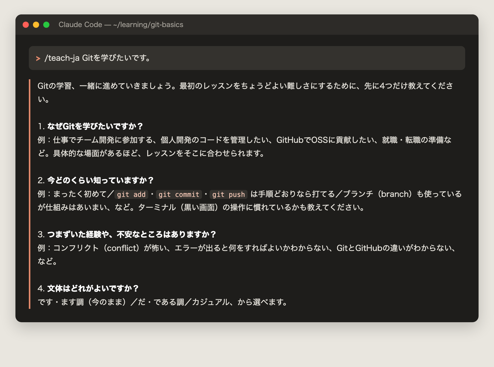

### Step 2 — Mission, sources, then the first lesson

After the answers, it writes `MISSION.md`, collects trusted sources into `RESOURCES.md`, records the starting point as learning record `0001`, and builds lesson 1 aimed at the learner's stated weak spot (staging vs. commit). It also proposes a rough 8-lesson path toward the mission.

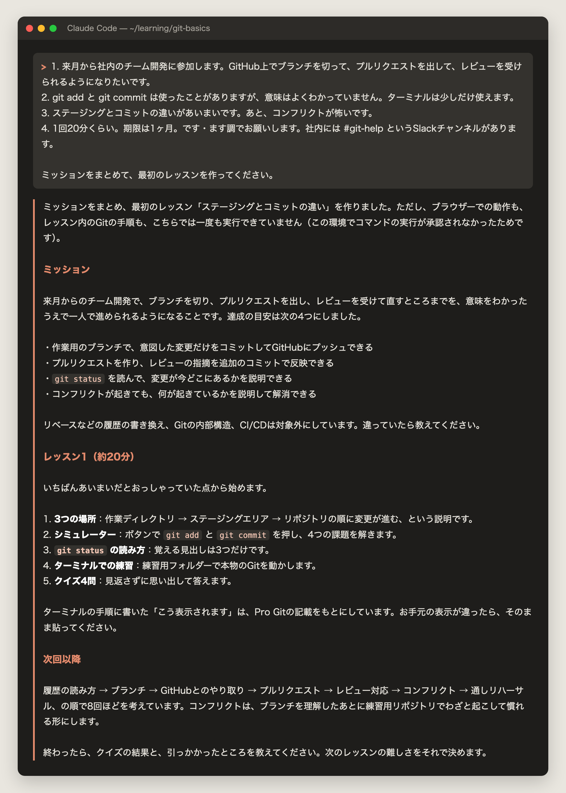

### Step 3 — The lesson: short, cited, tied to the mission

Each lesson is one self-contained HTML file using the shared Japanese stylesheet: one goal (今日できるようになること), the "why" for *this* learner (pull request reviews next month), a diagram, citations `[1]` `[2]`, and terms written as 「日本語（English）」 on first use.

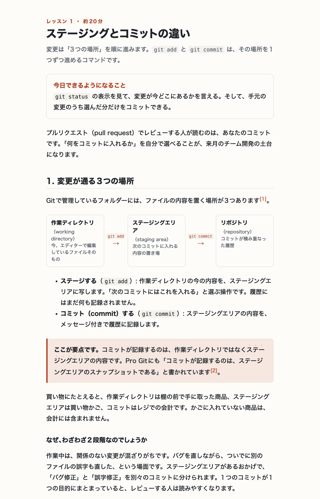

### Step 4 — Practice with immediate feedback

The skill wrote its own reusable component, `assets/three-areas.js`: a simulator where the learner presses `git add` / `git commit` and watches the three areas change, with a simplified `git status` underneath. Then a real-terminal exercise in a throwaway folder.

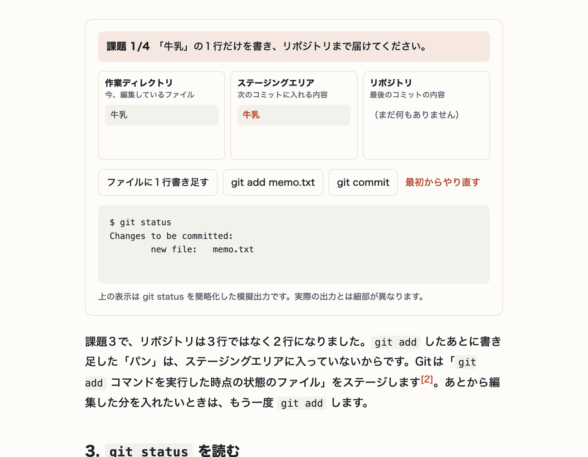

### Step 5 — Retrieval quiz (shuffled, equal-length answers)

Quiz options are the same length in characters and the same grammatical shape, and `assets/quiz.js` shuffles them on every load — the correct answer is in a different slot each time. Wrong answers explain *why* and cite the source.

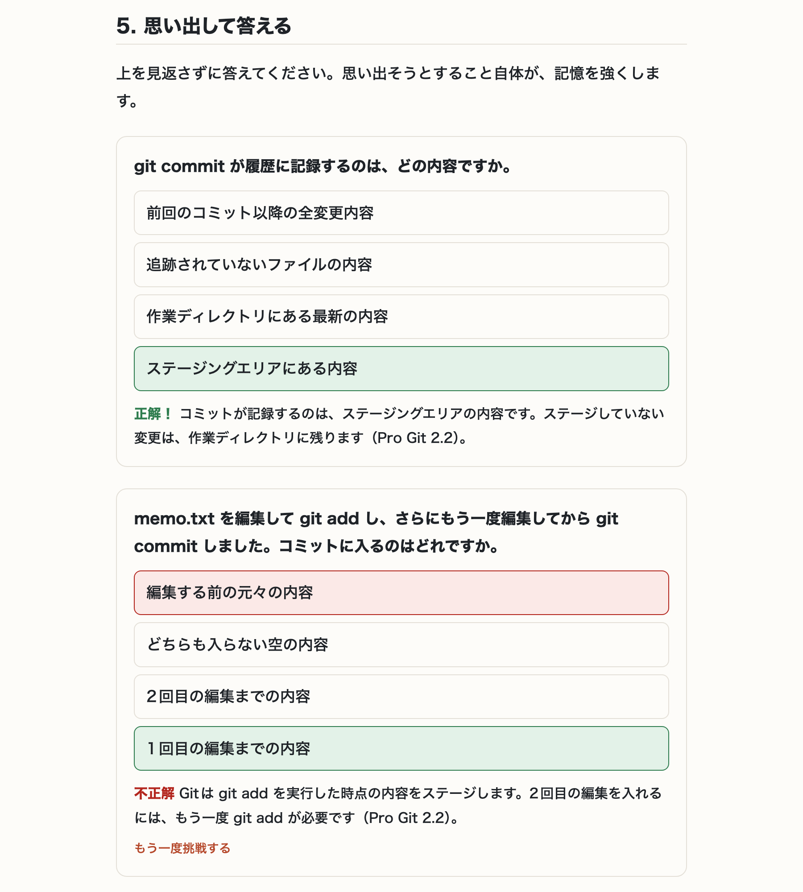

### Step 6 — Primary source, community, "ask your teacher"

Every lesson ends with one recommended primary source (the official Japanese Pro Git, with the English original and a warning that the translation is older), a pointer to the company's own `#git-help` channel, and a reminder to ask follow-up questions.

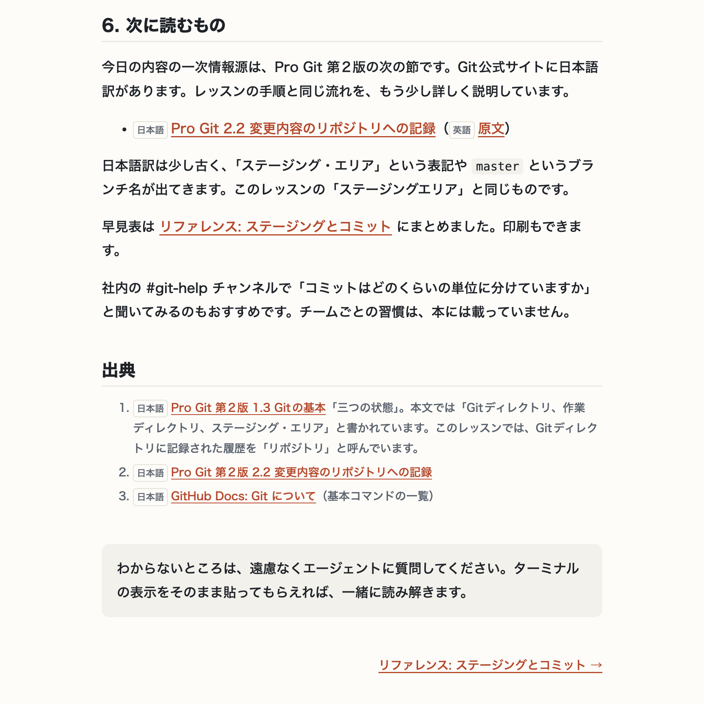

A printable reference sheet (`reference/staging-and-commit.html`) is produced alongside the lesson — the thing you come back to later:

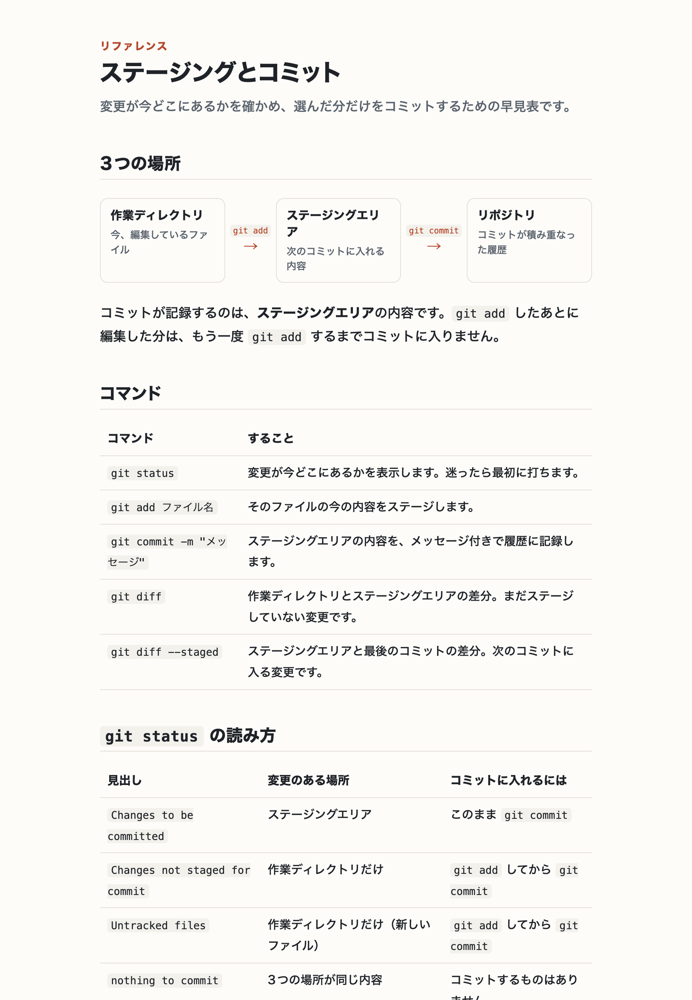

### Step 7 — The learner reports back → memory is written

The learner says they got 3/4, explains the mistake, and puts the idea in their own words: 「ステージングエリアは次のコミットの下書き」. Because that is *evidence* of understanding and a *corrected misconception*, the skill writes learning record `0002`, creates `GLOSSARY.md` (using the learner's phrase), and plans spaced review for next time.

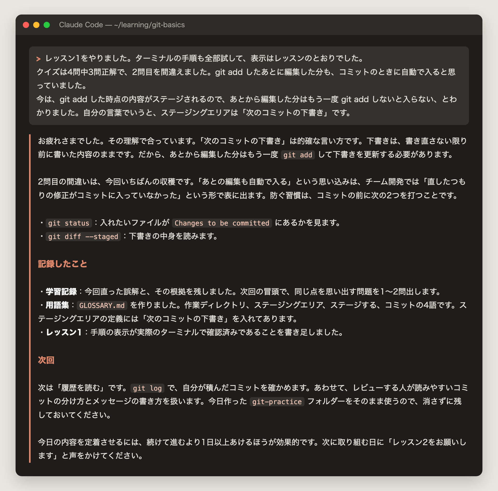

### Step 8 — Close the chat. New session. 「次のレッスン」

This is the part to show your colleagues. A **new** Claude Code session — no chat history at all — in the same folder:

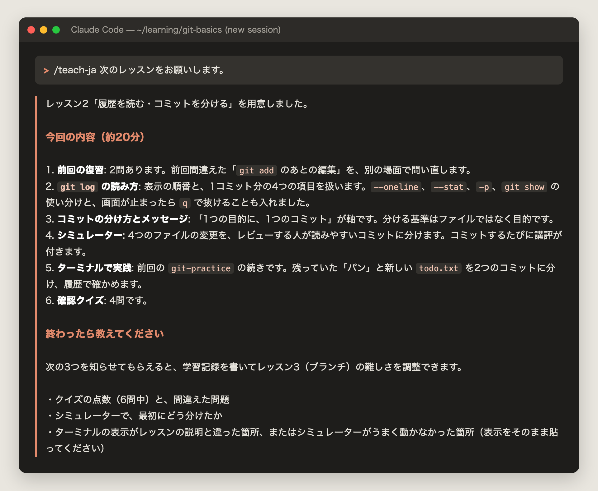

It read the folder, not the old chat, and that shows:

- Lesson 2 **opens with spaced review** of exactly the misconception recorded in `learning-records/0002` (asked from a new angle).
- It continues the learner's `git-practice` folder from lesson 1, including the 「パン」 line left unstaged there.
- The new simulator labels the staging area 「次のコミットの下書き」 — **the learner's own words**, picked up from `GLOSSARY.md`.

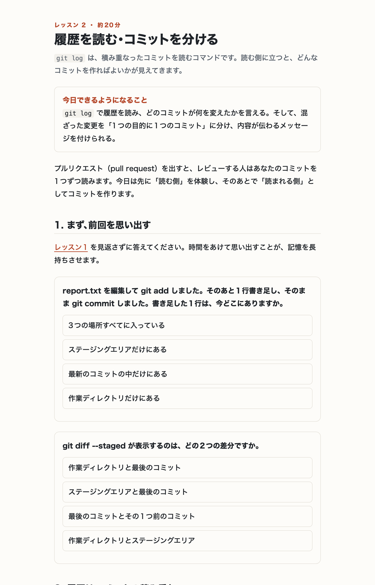

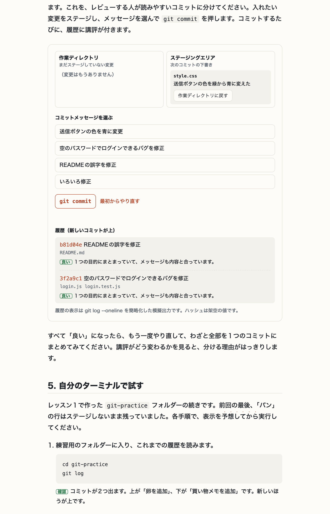

> **About the recording.** For safety, the recorded runs could not execute `git`, `node` or `open` (only read/write files, web search, `mkdir`/`cp`). Claude says so honestly in its replies; those environment notes and local paths were trimmed from the chat screenshots. Every Git step in both lessons was then run against real Git and matches what the lessons say, and the JavaScript components were clicked through in a browser with no errors.

---

## 2. How it works inside

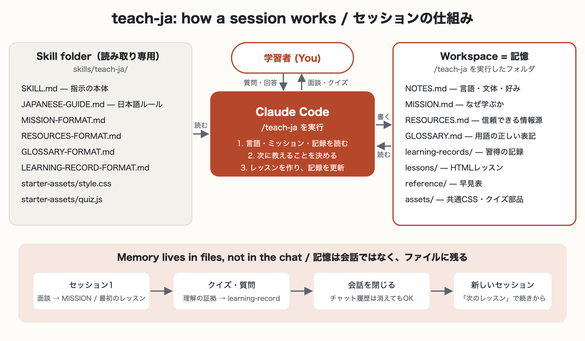

A Claude Code **skill** is just a folder with a `SKILL.md` file: Markdown instructions plus a small YAML header. When you type `/teach-ja`, Claude Code loads that file into the conversation, and Claude follows it. There is no server, database or extra code — the "program" is the instructions, and the "state" is the files Claude writes.

```yaml
---
name: teach-ja
description: Teach the user a new skill or concept, within this workspace, in Japanese or English (日本語対応の /teach).
disable-model-invocation: true        # only runs when YOU type /teach-ja; Claude won't start it by itself
argument-hint: "何を学びたいですか？ / What would you like to learn about?"
---
```

There are two folders involved, and keeping them apart is the key idea:

| | Skill folder (`skills/teach-ja/`) | Workspace (the folder you run `/teach-ja` in) |
| --- | --- | --- |
| What | The teacher's **rulebook** | The learner's **memory** |
| Who writes it | You / this repo | Claude, during sessions |
| Changes per learner? | No — shared by everyone | Yes — one per learner per topic |
| Contents | `SKILL.md`, `JAPANESE-GUIDE.md`, `*-FORMAT.md`, `starter-assets/` | `MISSION.md`, `NOTES.md`, `RESOURCES.md`, `GLOSSARY.md`, `learning-records/`, `lessons/`, `reference/`, `assets/` |

### What Claude does on every `/teach-ja`

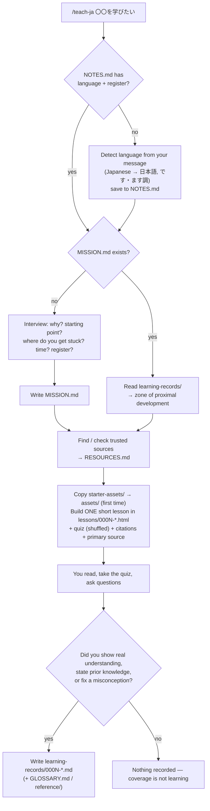

### The teaching ideas behind it

The skill encodes a few well-known learning-science ideas, and they explain most of its behaviour:

- **Mission first.** No lesson until it knows *why* you're learning. Without a concrete goal ("submit my own pull request next month") it can't choose what to teach next.
- **Knowledge → Skills → Wisdom.** Knowledge comes from trusted sources (it is told **never to trust its own memory**, and to cite). Skills come from practice with immediate feedback (quizzes, small tasks). Wisdom comes from real people, so it points you to communities — including your own team's channel.
- **Zone of proximal development.** Each lesson should be "just hard enough". It works this out from your learning records.
- **Storage strength over fluency.** Feeling fluent while reading is not the goal; remembering next month is. So lessons use retrieval practice (quizzes from memory), spacing and interleaving.
- **Small lessons.** One lesson = one tangible win in one sitting, because working memory is small.

---

## 3. How memory is saved

Claude has no hidden memory between chats. **The workspace folder *is* the memory.** Each file has one job:

| File | Written when | Read when | Example (from the demo) |
| --- | --- | --- | --- |
| `NOTES.md` | First session; whenever you state a preference | Every session, first | `言語 / Language: 日本語`, `文体 / Register: です・ます調` |
| `MISSION.md` | After the interview; when your goal changes (with your OK) | Every lesson decision | Why you're learning, what success looks like, starting point, constraints, out of scope |
| `RESOURCES.md` | Before / while building lessons | When writing any explanation | Official docs, books, communities, tagged ［日本語］/［英語］ |
| `learning-records/000N-*.md` | Only when there is **evidence** you learned something, you state prior knowledge, or a misconception is corrected | To choose the next lesson | `0001-staging-vs-commit.md` |
| `GLOSSARY.md` | When you can *use* a term correctly | Every lesson (it fixes spellings) | **コミット（commit）** … _避ける表現_: 確定、セーブ |
| `lessons/000N-*.html` | One per session | You, for review | Self-contained HTML lesson |
| `reference/*.html` | When a lesson produces something worth keeping | You, often (cheat sheets print on A4) | Command cheat sheet |
| `assets/` | First lesson (copied from `starter-assets/`), then grows | Before every lesson (reuse first) | `style.css`, `quiz.js` |

**Learning records are like ADRs (architecture decision records) for your brain.** They are short, numbered, never deleted — if your understanding changes, the old one is marked `status: superseded by LR-000N`. "We covered X" is *not* a record; "the learner explained X correctly in their own words" is.

Because memory is in files:

- You can **close the chat and come back next week**: open Claude Code in the same folder and say `/teach-ja 次のレッスン`.
- You can **read and edit** what Claude believes about you. Wrong level? Edit `MISSION.md` or a learning record.
- You can **commit the folder to Git** and share a course with your team.

After the four turns above, the workspace looks like this — every file Claude uses to "remember" the learner is a readable text file:

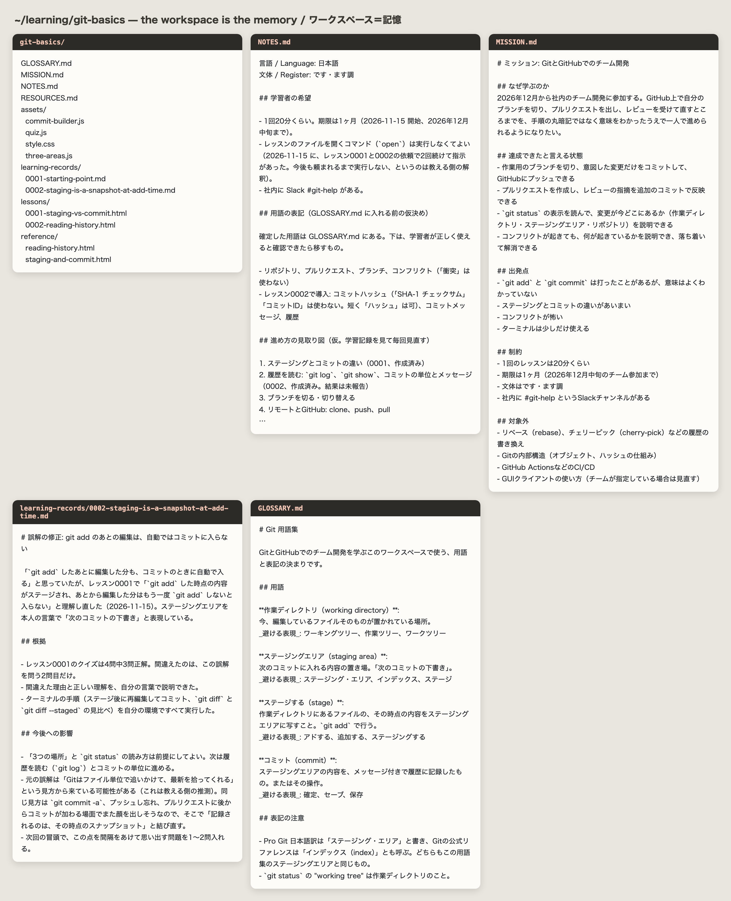

Things worth pointing out in a demo:

- `NOTES.md` starts with the language and register lines, so every future session speaks です・ます調 Japanese without being told.
- `learning-records/0002` contains **evidence** (3/4 on the quiz, explained the mistake in their own words), **implications** (what to teach next), and even a hypothesis about *why* the misconception happened and where it may reappear.
- `GLOSSARY.md` picks one spelling per concept and lists the ones to avoid — including why Pro Git's Japanese translation uses a different spelling.
- The learner can open and correct any of these. That *is* how you steer the teacher.

---

## 4. What we changed for Japanese

Full table with reasons: [CHANGES.md](./CHANGES.md). Untouched originals are in [`upstream/`](./upstream/) — run `diff -u upstream/SKILL.md skills/teach-ja/SKILL.md` to see every line.

| Problem with the original in Japanese | Fix in `teach-ja` |
| --- | --- |
| Never says which language to use | **Language / 言語** section: picks the language from `NOTES.md` or your messages and uses it everywhere, saves it |
| Tone drifts between です・ます and だ・である | Asks once, saves `文体 / Register` in `NOTES.md`, never mixes |
| One concept, three spellings (コミット / 確定 / commit) | First use shows 「日本語（English）」; afterwards the `GLOSSARY.md` spelling only; glossary lists `_避ける表現_` |
| Japanese file names break between Mac (NFD) and Windows (NFC), in Git and zip files | File names are always ASCII: `0001-staging-vs-commit.html` |
| Browsers fake-slant Japanese italics; Latin line-height is too tight | `starter-assets/style.css`: `lang="ja"`, Japanese font stack (Hiragino / Noto Sans JP / Yu Gothic / Meiryo), `line-height: 1.8`, `line-break: strict`, no italics, 傍点 emphasis, A4 print |
| "All answers have the same number of words" is meaningless without spaces | Same **character count (±2)** and same sentence ending |
| Upstream bug: correct quiz answer is almost always option A | `starter-assets/quiz.js` shuffles options at render time |
| English-only sources and communities | Official Japanese translations (checked for lag), connpass, teratail, Qiita/Zenn for output, and your company's own channels |
| First lessons often assume too much | Mission gains a **出発点 (starting point)** section, asked in the interview |

---

## 5. Install

You need [Claude Code](https://docs.claude.com/en/docs/claude-code/overview) (CLI, desktop app or IDE extension).

### Option A — as a plugin (recommended for a team)

Push this repo to your company's Git host, then each colleague runs inside Claude Code:

```text
/plugin marketplace add <your-org>/teach-ja
/plugin install teach-ja@teach-ja
```

For a local clone, use the path instead: `/plugin marketplace add ./teach-ja`.

### Option B — as a personal skill (quickest)

```bash
git clone <this-repo-url> teach-ja
```

```bash
mkdir -p ~/.claude/skills && cp -R teach-ja/skills/teach-ja ~/.claude/skills/
```

### Option C — try without installing

```bash
claude --plugin-dir /path/to/teach-ja
```

### Use it

```bash
mkdir -p ~/learning/git-basics && cd ~/learning/git-basics && claude
```

Then type:

```text
/teach-ja Gitを学びたいです。
```

Use **one folder per topic**, outside your work projects. Next time, open Claude Code in the same folder and type `/teach-ja 次のレッスン`.

---

## 6. Running the demo yourself

The exact prompts used to create [`examples/git-basics/`](./examples/git-basics/) are in [`examples/git-basics/DEMO-SCRIPT.md`](./examples/git-basics/DEMO-SCRIPT.md). For a live demo:

1. Open an empty folder in Claude Code and run `/teach-ja Gitを学びたいです。` — show the interview.
2. Paste the interview answers — show `MISSION.md`, `NOTES.md` and the first lesson being written.
3. Open the lesson in a browser — take the quiz, reload to show the options shuffle.
4. Answer the teacher's check question in your own words — show the new file in `learning-records/`.
5. **Close Claude Code. Open a new session in the same folder** and type `/teach-ja 次のレッスン` — show that it continues from the records instead of starting over.

Step 5 is the "aha" moment for most people: the memory is the folder.

---

## 7. Tips, limits and FAQ

**Will it make things up?** It can. The skill forces citations and a recommended primary source in every lesson so checking is cheap — but you still need to check, especially for exact procedures and notation.

**Do I stay in one chat?** Either way works. The state is in the folder, so a fresh session is fine and often better.

**Does it schedule reviews (spaced repetition)?** No. Lessons are designed for retrieval practice, but nothing reminds you. Ask for "復習" explicitly when you want review instead of new material.

**English colleagues?** Write to it in English, or put `言語 / Language: English` in `NOTES.md`. The same skill works in both.

**Which model?** Higher-capability models and higher effort produce noticeably better lessons.

**Is it only for programming?** No — any topic works: languages, certifications, business skills, hobbies.

---

## 8. Repository layout

```text
teach-ja/
├── .claude-plugin/
│   ├── plugin.json          # plugin manifest
│   └── marketplace.json     # lets /plugin marketplace add this repo
├── skills/teach-ja/
│   ├── SKILL.md             # the instructions Claude follows
│   ├── JAPANESE-GUIDE.md    # Japanese register, terms, typography, quizzes, sources
│   ├── MISSION-FORMAT.md    # bilingual templates for each memory file
│   ├── RESOURCES-FORMAT.md
│   ├── GLOSSARY-FORMAT.md
│   ├── LEARNING-RECORD-FORMAT.md
│   └── starter-assets/
│       ├── style.css        # Japanese-ready lesson stylesheet
│       └── quiz.js          # quiz component that shuffles answers
├── examples/git-basics/     # a real workspace produced by the skill, in Japanese
├── docs/images/             # screenshots and diagrams used here
├── upstream/                # original mattpocock/skills teach files, unmodified
├── CHANGES.md               # every change vs upstream, with reasons
├── README.md / README.ja.md
└── LICENSE                  # MIT (original + this fork)
```

---
